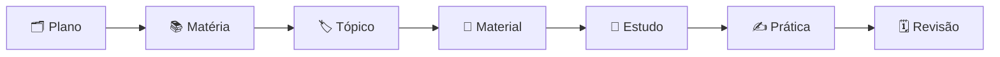

# Organiza ✦

> **Seu espaço para estudar com clareza, do primeiro PDF até a revisão.**

O **Organiza** reúne o que normalmente fica espalhado entre apostilas, links, anotações e listas de exercícios. Ele foi pensado para quem se prepara para ENEM, vestibulares, PAS, concursos ou qualquer meta que peça constância.

  <strong>🗂️ Planeje</strong> &nbsp;·&nbsp;
  <strong>📖 Estude</strong> &nbsp;·&nbsp;
  <strong>✍️ Pratique</strong> &nbsp;·&nbsp;
  <strong>🗓️ Revise</strong>

---

## ✦ Um caminho simples para estudar

Você começa criando um plano, como “ENEM 2027” ou “Concurso da minha área”. Dentro dele, organiza as matérias e seus tópicos. Depois, adiciona os materiais que vai usar e o Organiza ajuda a transformar cada sessão de estudo em um histórico que faz sentido.

### 01 · 🗂️ Organize seu objetivo

Crie planos de estudo e dê uma identidade a cada um deles. Em seguida, distribua as matérias, tópicos e subtópicos do jeito que combina com a sua preparação.

### 02 · 📚 Monte sua biblioteca

Guarde PDFs, imagens, slides, textos, links e anotações junto da matéria certa. Assim, quando for estudar um tema, o conteúdo necessário já estará no mesmo lugar.

### 03 · 🖍️ Estude sem perder o ponto

O leitor de PDF lembra a última página visitada, permite marcar o material como concluído e registra suas sessões de estudo. Você pode destacar partes importantes com a cor e a intensidade que preferir, sublinhar com linhas retas e salvar as marcações para consultar depois.

### 04 · 🗓️ Volte ao que importa

As revisões mantêm os materiais em circulação. A agenda mostra o que está pendente, o que venceu e o próximo conteúdo para retomar, sem transformar o dia em uma lista impossível.

---

## ✦ O que você encontra no Organiza

| Espaço | Para que serve |
| --- | --- |
| **🏠 Visão geral** | Mostra o que continuar estudando, as prioridades do dia, o progresso por matéria e a atividade recente. |
| **🗂️ Meus planos** | Reúne seus objetivos de estudo, matérias e tópicos em uma estrutura fácil de acompanhar. |
| **📚 Minha Biblioteca** | Mantém materiais, links, textos e anotações organizados por assunto. |
| **🖍️ Leitor de PDF** | Abre o material no próprio app, guarda o ponto de leitura e permite realçar, sublinhar e salvar marcações. |
| **📝 Anotações** | Guarda resumos, dúvidas e observações vinculados às disciplinas. |
| **✍️ Prática** | Permite cadastrar e responder questões, rever tentativas e acompanhar acertos e erros. |
| **🗓️ Revisões** | Organiza retornos automáticos e manuais para que nenhum conteúdo fique esquecido. |
| **🎯 Metas semanais** | Ajuda a definir e acompanhar uma meta de tempo de estudo e de questões. |
| **📈 Relatórios** | Exibe seu ritmo semanal, tempo dedicado, prática, aproveitamento e revisões concluídas. |
| **🔎 Pesquisar** | Localiza matérias, tópicos, materiais e questões sem precisar navegar por toda a estrutura. |
| **⬇️ Meus dados** | Permite baixar seus registros em planilhas para manter uma cópia organizada. |

---

## ✦ Um exemplo de rotina

1. Crie o plano **“ENEM 2027”**.
2. Adicione a matéria **História** e o tópico **Era Vargas**.
3. Envie uma apostila ou slide para a biblioteca.
4. Leia no próprio Organiza, faça realces e registre os pontos importantes.
5. Resolva as questões do tema quando estiver pronto.
6. Volte à agenda para revisar o conteúdo no momento indicado.

O painel acompanha esse percurso com dados da sua própria atividade: sessões concluídas, materiais finalizados, questões respondidas e revisões feitas.

---

## 🔒 Feito para o seu acervo

- Cada conta vê somente seus próprios planos, materiais e registros.
- Seus PDFs enviados ficam protegidos e são acessados apenas dentro da sua área de estudos.
- As marcações do leitor são salvas para que você retome a leitura como deixou.
- O progresso mostrado no painel vem de ações reais realizadas na plataforma.
- A conta inclui confirmação de e-mail e recuperação de senha.

---

## ✦ Comece por aqui

Crie sua conta, abra **Meus planos** e monte o primeiro objetivo. Com uma matéria e um material, a sua rotina já pode começar a ganhar forma.

  <strong>Organiza</strong> 
  Um lugar mais calmo para cuidar dos seus estudos.

